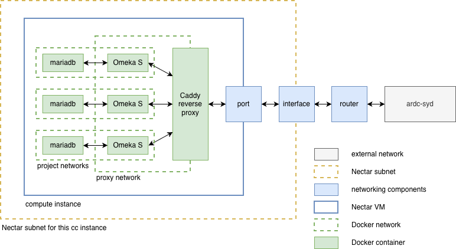
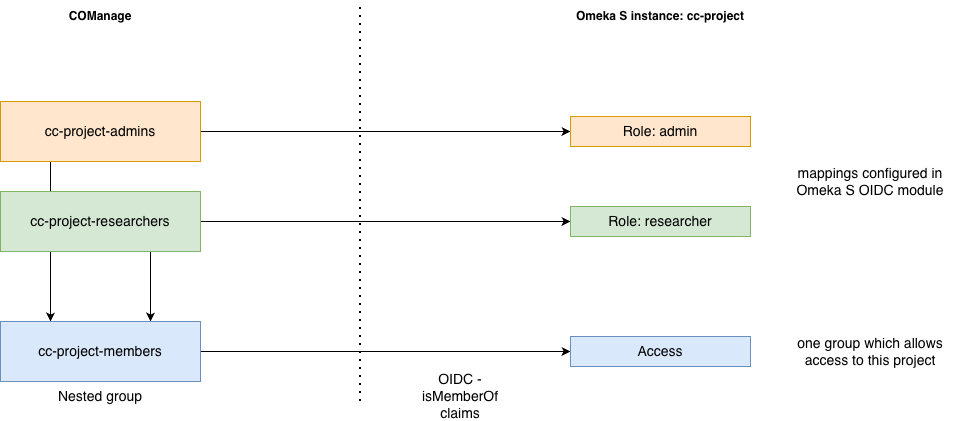
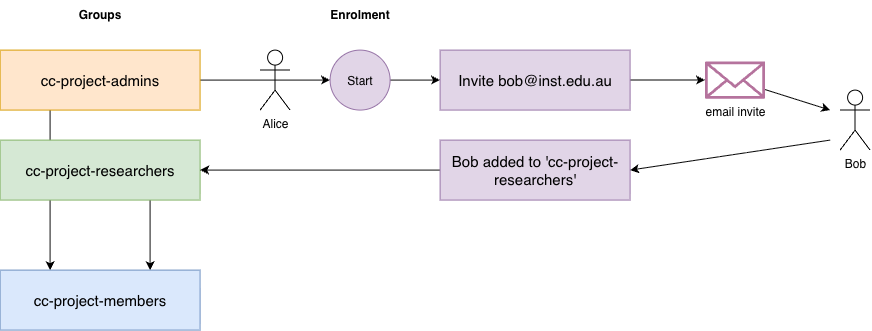

# Curated Collections Deploy Scripts

This is a Terraform module to install the Curated Collections
distribution of Omeka S to Nectar via its OpenStack API.

**New operators:** see [docs/provisioning.md](docs/provisioning.md) for
step-by-step setup and how to add a new Omeka S project.

## What the module does

The module creates the following on Nectar:

- a network, subnet, router and interface
- a compute instance
- a fixed IP and a port attached to the compute instance and the network interface
- several Omeka S instances (these are referred to as "projects")
- DNS records for each project, pointing at the fixed IP
- a Caddy reverse proxy which routes incoming requests to the correct Omeka S instances based on the hostname

To plan the installation, run

    > terraform plan

To apply the installation, run

    > terraform apply

To destroy the installation, run

    > terraform destroy

WARNING: this setup doesn't export data before tearing down the build,
so 'destroy' really means destroy: any data which has been added to
the server will be lost for good. See the Todo section.

## Configuration

### variables.tf

Global config values which aren't secrets

- cc_domain - the base domain for Curated Collections

### openstack-variables.tf

Global config values - some of these are secret so the file is
in .gitignore

- openstack_user
- openstack_password
- nectar_project_id
- nectar_project_name

### project-variables.tf

Project-specific config

- cc_project_id - a unique string for this project in Curated Collections, will be used as the hostname as in  ${cc_project_id}.curated-collections.cloud.edu,au
- omeka_admin_email - email address for the local admin account
- omeka_admin_user - username for the local admin account
- omeka_project_title - the installation title
- omeka_site_title - the default public site title
- omeka_site_slug - the default public site's slug (url path)
- cilogon_group - a group on the Curated Collections CILogon registry - all members of this group will be allowed to log in to this instance
- oidc_roles_map - a mapping from CILogon groups to Omeka S roles. See the OIDC section below for details
- oidc_hide_local_login - a boolean indicating whether local authentication should be hidden.

## Secrets

The Terraform module generates random passwords for the database (used
when the Omeka S container communicates with MariaDB) and for the
local admin user.

You can get a project's local admin password with the command

    > echo 'nonsensitive(random_password.omeka_admin_password["<project>"].result)' | terraform console

You shouldn't need to use the db passwords, but you can get them the same way using `mariadb_password` or `mariadb_root_password`.

## OIDC

Most Omeka S instances have three groups in CILogin:

- a group of admin users (typically the CI)
- a group of regular users ("members")
- a group of all project members

The "all project members" group is a nested group to which users
are automatically added if they are a member of either the admin or
the members group. This gives us a single group to be used as the
way of controlling who gets to log in, without needing to keep it in
sync with the two subsets which control what level of privilege a
user will get.

Members join the CILogon groups by an enrolment workflow (set up by
the Curated Collections team when provisioning an instance) for the
instance. Anyone in the admin group can send an invite to enrol in
the team - when the user responds to the invite and joins, they are
assigned into the project members group.

Some project which want to allow self-enrolment for community
participants (ie without an admin inviting them) will require a third
group for self-enrolled users - this will map to an Omeka S role like
"author" which gives them fewer privileges (they can't delete or edit
other user's items)

# To do

Volume filesystem formatting on create
